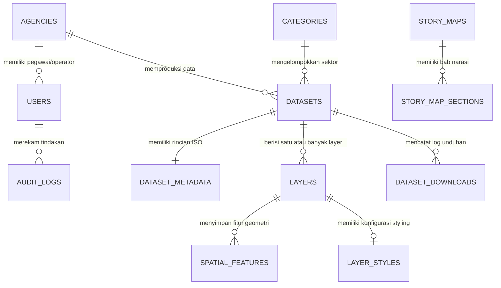

# 🗺️ DOKUMEN KOMPREHENSIF PROYEK: PETAKITA ACEH
## Platform Geoportal & WebGIS Data Spasial Terpadu Pemerintah Provinsi Aceh
**Dokumen Penjelasan Lengkap Proyek untuk Bahan Bimbingan Supervisor / Dosen Pembimbing**

---

## 📌 Ringkasan Eksekutif (Executive Summary)

* **Nama Proyek**: **PetaKita Aceh** (*Platform Geoportal Data Spasial Aceh*)
* **Entitas Pengguna**: Pemerintah Provinsi Aceh (Bappeda Aceh, Dinas Komunikasi, Informatika dan Persandian Aceh, serta seluruh Organisasi Perangkat Daerah / SKPA)
* **Kategori Aplikasi**: *Enterprise WebGIS, Spatial Data Infrastructure (SDI), Geoportal & Open Data Management System*
* **Tujuan Utama**: Mewujudkan **Kebijakan Satu Peta (One Map Policy)** dan **Satu Data Indonesia** di Provinsi Aceh melalui platform geospasial terpadu yang memfasilitasi integrasi, standarisasi metadata (SNI ISO 19115), visualisasi interaktif, pembagian hak akses bertingkat (RBAC & Data Privacy), serta interoperabilitas data antar instansi via REST API.
* **Status Pengembangan Saat Ini**: **Fase Siap Uji (Production-Ready Staging)** dengan server lokal aktif, seluruh skema migrasi dan seeder batas administrasi riil 23 Kabupaten/Kota Aceh terpasang, integrasi REST API v2, dan seluruh unit test otomatis lulus 100%.

---

## 🎯 1. Latar Belakang & Urgensi Proyek

### 1.1 Permasalahan yang Diselesaikan
1. **Silo Data Spasial Antar Dinas (OPD/SKPA)**: Selama ini, data geospasial di Aceh tersebar di masing-masing instansi dalam format yang berbeda (Shapefile, CAD, spreadsheet, GeoTIFF) tanpa satu pusat katalog yang terstandar. Hal ini menyebabkan duplikasi data, ketidaksinkronan batas wilayah, dan pemborosan anggaran pemetaan.
2. **Ketiadaan Standarisasi Metadata**: Banyak data spasial tidak memiliki keterangan riwayat (*lineage*), akurasi, tahun pembuatan, maupun produsen data resmi, sehingga menyulitkan proses audit dan validitas perencanaan pembangunan.
3. **Kebutuhan Klasifikasi Privasi Data**: Tidak semua data spasial dapat dibuka untuk publik. Dibutuhkan sistem yang membedakan data publik (dapat diunduh masyarakat luas), data terbatas (hanya dapat diakses dinas tertentu), dan data tertutup/rahasia (hanya internal administrator).
4. **Keterbatasan Aksesibilitas Publik & Pengambil Keputusan**: Masyarakat, akademisi, dan pimpinan daerah membutuhkan peta tematik dan *story map* interaktif yang mudah dipahami tanpa memerlukan perangkat lunak GIS desktop yang berat (seperti ArcGIS atau QGIS).

### 1.2 Tujuan & Manfaat Proyek
* **Bagi Pemerintah Provinsi Aceh**: Memiliki pusat kendali (*node geospasial*) resmi untuk perencanaan tata ruang, mitigasi bencana, pembangunan infrastruktur, dan analisis berbasis wilayah secara akurat.
* **Bagi Instansi / OPD (SKPA)**: Memiliki portal mandiri untuk mengunggah layer spasial dinasnya dengan alur persetujuan (*approval workflow*) resmi sebelum tayang ke publik.
* **Bagi Masyarakat & Peneliti**: Kemudahan mencari, memvisualisasikan, dan mengunduh data spasial terbuka dalam format standar industri (GeoJSON/CSV) lengkap dengan metadata SNI.

---

## 💻 2. Arsitektur Sistem & Spesifikasi Teknologi (Tech Stack)

Aplikasi dibangun menggunakan arsitektur modern berkinerja tinggi yang mengombinasikan ketangguhan *framework* skala enterprise, kapabilitas komputasi spasial murni di level basis data, serta antarmuka web interaktif yang responsif.

```
+-----------------------------------------------------------------------------------+
|                            LAPISAN PENGGUNA (FRONTEND)                            |
|  +-------------------+  +-----------------------+  +---------------------------+  |
|  |  Landing Portal   |  | WebGIS Viewer Leaflet |  |   Filament Admin Panel    |  |
|  | (Blade/Tailwind4) |  | (Spatial Tools & GIS) |  | (Role-Based Control Panel)|  |
|  +-------------------+  +-----------------------+  +---------------------------+  |
+-----------------------------------------^-----------------------------------------+
                                          | HTTP / JSON / SSE
+-----------------------------------------v-----------------------------------------+
|                        LAPISAN LOGIKA BISNIS (BACKEND CORE)                       |
|  +-----------------------------------------------------------------------------+  |
|  |                         LARAVEL 12 (PHP 8.2+ LTS)                           |  |
|  |  * Routing & Middleware (Rate Limiter, Role Authorization, Cache Isolation) |  |
|  |  * Spatial Services: GeoConversion, ShapefileParser, XmlMetadataParser     |  |
|  |  * Integration Services: SIG Aceh API v2 & BNPB/BPBA Disaster Sync        |  |
|  |  * Analytics Engine: Dataset Download Tracking & Anti-Spam Logger          |  |
|  +-----------------------------------------------------------------------------+  |
+-----------------------------------------^-----------------------------------------+
|                                         | SQL / PostGIS Functions                 |
+-----------------------------------------v-----------------------------------------+
|                    LAPISAN DATA SPASIAL & PENYIMPANAN PERSISTEN                   |
|  +-----------------------------------------------------------------------------+  |
|  |                  POSTGRESQL 14+ DILENGKAPI POSTGIS EXTENSION                |  |
|  |  * Geometri Spasial EPSG:4326 (WGS 84): Point, MultiPolygon, LineString     |  |
|  |  * Spatial Indexing (GiST Indexes) untuk Optimasi Query BBOX & Intersect   |  |
|  |  * Atribut JSONB Fleksibel & Audit Trail Logs                              |  |
|  +-----------------------------------------------------------------------------+  |
+-----------------------------------------------------------------------------------+
```

### Rincian Komponen Teknologi:

| Komponen / Lapis | Teknologi yang Digunakan | Alasan Pemilihan & Peran |
| :--- | :--- | :--- |
| **Backend Framework** | **Laravel 12 (PHP 8.2+)** | Framework PHP modern generasi terbaru. Menyediakan ekosistem keamanan tinggi (CSRF, XSS, SQL Injection prevention), sistem migrasi terstruktur, Eloquent ORM, dan *dependency injection*. |
| **Spatial Database** | **PostgreSQL + PostGIS** | Standar emas industri GIS global untuk basis data relasional spasial. Menggunakan fungsi asli `ST_AsGeoJSON`, `ST_Intersects`, `ST_MakeEnvelope`, dan pengindeksan spasial `GiST` untuk query koordinat secepat kilat. |
| **Admin Panel & CMS** | **Filament v3/v4** | Panel administrasi berbasis TALL-stack yang elegan dan cepat. Digunakan untuk manajemen data master OPD, moderasi dataset, pengelolaan layer, hak akses pengguna, dan dashboard visual. |
| **Peta Interaktif Web** | **Leaflet JS v1.9.4** | Library pemetaan open-source yang ringan, cepat dimuat pada perangkat bergerak (*mobile-friendly*), dan mendukung multi-layer raster/vektor. |
| **Styling & Tampilan** | **Tailwind CSS v4 & Custom CSS** | Menghasilkan estetika modern bertema khas Aceh (aksen hijau zamrud & emas), tipografi Inter dari Google Fonts, antarmuka kartu glassmorphic, dan responsif di semua ukuran layar. |
| **Build Tool & Bundler** | **Vite v7** | Tool bundling generasi terbaru dengan *Hot Module Replacement* (HMR) untuk kompilasi aset CSS dan JavaScript instan. |
| **Standar Metadata** | **SNI ISO 19115:2012** | Standar Nasional Indonesia untuk metadata geospasial (skema identifikasi, cakupan geografis BBOX, riwayat data/lineage, kontak produsen). |
| **Standar Koordinat** | **EPSG:4326 (WGS 84)** | Sistem referensi spasial global standar GPS dan GeoJSON yang kompatibel dengan seluruh pustaka pemetaan modern. |
| **Pengujian Otomatis** | **PHPUnit / Pest** | Pengujian regresi otomatis untuk memvalidasi keamanan endpoint data rahasia, integritas stream GeoJSON, dan pelacakan unduhan. |

---

## 🗄️ 3. Skema Basis Data & Struktur Relasi (Database Schema)

Sistem menggunakan 12 tabel utama yang saling berelasi secara terstruktur:



### Rincian Tabel Utama:
1. **`agencies`**: Menyimpan daftar Organisasi Perangkat Daerah (OPD/SKPA) seperti Bappeda, Dinas PUPR, Dinas Kesehatan, DLHK, BPBA, Disdik, Distanbun, dan Biro Pemerintahan.
2. **`categories`**: Klasifikasi sektor data spasial (Batas Administrasi, Infrastruktur, Tata Ruang, Lingkungan Hidup, Kebencanaan, Fasilitas Kesehatan, Pendidikan).
3. **`users`**: Data pengguna sistem dengan pembagian peran (`admin` dan `operator`), lengkap dengan kaitan ke instansi asal (`agency_id`).
4. **`datasets`**: Entitas utama dataset spasial. Menyimpan judul, deskripsi, tahun rilis, lisensi, tingkat kerahasiaan (`access_level`: *public, restricted, private*), daftar instansi yang diizinkan (`allowed_agencies`), dan status publikasi (`draft, pending_review, published, archived`).
5. **`dataset_metadata`**: Metadata lengkap berstandar **SNI ISO 19115:2012**, mencakup judul alternatif, abstrak, tujuan, tipe representasi spasial, skala, bounding box geografis (`minX, minY, maxX, maxY`), rentang waktu temporal, lineage (riwayat perolehan data), kualitas data, dan kontak narahubung.
6. **`layers`**: Lapisan peta spasial yang terikat pada dataset (tipe: GeoJSON, Shapefile, WMS, atau Tile Layer).
7. **`spatial_features`**: Tabel inti penyimpanan geometri PostGIS (kolom `geom` tipe geometry dengan SRID 4326), properti atribut dalam format JSONB, serta relasi kode wilayah (kabupaten/kecamatan).
8. **`layer_styles`**: Konfigurasi visualisasi peta (warna garis/stroke, warna isian/fill, transparansi/opacity, ketebalan border, dan ikon penanda).
9. **`dataset_downloads`**: Log analitik setiap pengunduhan file spasial oleh publik (mencatat IP, User-Agent, referer, dan timestamp).
10. **`thematic_maps`**: Koleksi peta tematik terkurasi (baik tipe layout kartografi beresolusi tinggi maupun tipe interaktif dinamis).
11. **`story_maps` & `story_map_sections`**: Modul narasi spasial interaktif berbasis bab (*scrollytelling*) untuk menjelaskan isu pembangunan Aceh.
12. **`audit_logs`**: Rekam jejak seluruh aktivitas krusial pengguna (perubahan status publikasi, pengubahan hak akses, penghapusan layer).

---

## 🌟 4. Fitur-Fitur Utama Aplikasi (End-to-End Features)

### 4.1 Halaman Beranda (Landing Page & Portal Informasi)
* **Hero Banner Interaktif**: Desain modern bernuansa Aceh dengan kolom pencarian instan yang mengarahkan pengguna ke katalog atau langsung membuka WebGIS viewer.
* **Statistik Data Spasial Real-Time (Live Metrics)**: Menampilkan jumlah dataset publik, instansi produsen data terdaftar, total layer spasial, dan total riwayat unduhan yang dihitung secara dinamis dari basis data.
* **Katalog Sorotan & Peta Unggulan**: Menampilkan dataset terbaru, peta tematik rekomendasi, dan *story maps* pilihan.

### 4.2 WebGIS Viewer Interaktif (`/map`)
* **Layer Switcher Multi-Sumber**:
  * Peta Standar Jalanan (*OpenStreetMap*)
  * Citra Satelit Beresolusi Tinggi (*ESRI World Imagery / Google Hybrid*)
  * Peta Topografi & Kontur Ketinggian (*OpenTopoMap*)
  * Peta Mode Gelap (*CartoDB Dark Matter*) untuk kenyamanan analisis malam hari.
* **Integrasi Batas Wilayah Administrasi Riil**:
  * Visualisasi poligon batas wilayah resmi 23 Kabupaten/Kota dan 290 Kecamatan di Provinsi Aceh (menggunakan data koordinat poligon asli, bukan kotak simulasi).
* **Spatial Attribute Inspector**:
  * Saat pengguna mengklik salah satu poligon/titik di peta, panel samping kanan (*Inspector*) akan terbuka otomatis menampilkan seluruh informasi atribut tabular objek tersebut.
* **Fitur Ekspor Atribut ke CSV**:
  * Pengguna dapat langsung mengunduh tabel atribut dari objek yang sedang dibuka ke dalam berkas format `.csv`.
* **Alat Pengukuran Spasial (Measurement Tools)**:
  * **Ukur Jarak**: Menghitung panjang garis dalam satuan Meter atau Kilometer.
  * **Ukur Luas Wilayah**: Menggambar poligon bebas untuk menghitung luasan secara instan dalam satuan Meter Persegi (m²) dan Hektar (Ha).
* **Fitur Cetak Peta Resmi (*Print Map Layout*)**:
  * Menghasilkan tata letak cetak dokumen berformat standar kartografi pemerintah, lengkap dengan judul peta, legenda warna, orientasi utara (arah mata angin), dan skala peta.
* **Pencarian Lokasi (*Geocoding Autocomplete*)**:
  * Pengguna cukup mengetikkan nama desa, kecamatan, atau kabupaten di Aceh, sistem akan memberikan saran pencarian dan melakukan animasi *flyTo/zoom* otomatis ke lokasi yang dituju.

### 4.3 Katalog Dataset Spasial (`/katalog`)
* **Penyaringan Cepat (Instant Filtering)**: Filter dataset berdasarkan sektor kategori (Lingkungan Hidup, Infrastruktur, Bencana, dll.) dan instansi OPD pengunggah.
* **Lembar Metadata SNI ISO 19115**: Halaman detail menyajikan data terstruktur lengkap: identifikasi, sistem koordinat, akurasi, tahun data, lisensi, hingga tombol unduh GeoJSON.
* **Pratinjau Peta Cepat (*Map Preview*)**: Setiap kartu dataset dilengkapi peta mini interaktif untuk melihat sebaran data spasial sebelum diunduh.

### 4.4 Story Maps — Penceritaan Geospasial (`/story-maps`)
* Menggabungkan narasi teks, dokumentasi foto, dan navigasi peta otomatis (*scrollytelling*).
* Contoh implementasi: *Peta Sejarah & Mitigasi Tsunami Aceh 2004*, *Perkembangan Koridor Tol Trans-Sumatera Ruas Sigli-Banda Aceh*, dan *Kawasan Konservasi Ekosistem Leuser*.

### 4.5 Panel Administrasi Berbasis Peran (Filament Admin Panel - `/admin`)
* **Alur Persetujuan Bertingkat (Approval Workflow)**:
  1. **Operator Dinas (SKPA)**: Mengunggah dataset dan layer dinasnya sendiri. Status otomatis tersimpan sebagai `pending_review` (Menunggu Tinjauan). Operator tidak memiliki wewenang untuk langsung mempublikasikan data ke publik.
  2. **Administrator (Super Admin)**: Memeriksa validitas data spasial dan kelengkapan metadata. Admin berwenang menyetujui (`published`), meminta revisi, atau menolak/menghapus data.
* **Otomatisasi Parser Metadata XML**: Operator cukup mengunggah berkas XML ISO 19115, sistem secara otomatis mengekstrak judul, abstrak, dan batas koordinat (*Bounding Box*) tanpa perlu diketik manual.
* **Manajemen Pengguna & Instansi**: Penambahan akun operator dinas baru dengan isolasi hak akses sesuai instansinya masing-masing.

---

## 🔒 5. Keamanan Data, Hak Akses (RBAC), & Perlindungan Privasi

### 5.1 Tiga Tingkat Aksesibilitas Data (Data Confidentiality)
1. **Publik (`public`)**: Data terbuka yang dapat dicari, dilihat, dan diunduh oleh seluruh masyarakat umum tanpa login.
2. **Terbatas (`restricted`)**: Data yang mengandung nilai sensitif antar dinas. Hanya dapat dilihat oleh instansi pembuat dan daftar instansi lain yang telah diberi izin (*whitelisted agencies*) melalui kolom `allowed_agencies`.
3. **Tertutup / Rahasia (`private`)**: Data internal yang hanya boleh diakses oleh Administrator utama untuk keperluan audit dan keamanan negara/daerah.

### 5.2 Keamanan Endpoint & Isolasi Cache Spasial
* **Spatial Cache Privacy**: Query spasial untuk data publik disimpan di cache global berkinerja tinggi. Namun, untuk data terbatas/privat, *cache key* diisolasi secara ketat berdasarkan token otentikasi pengguna, menjamin **tidak ada kebocoran data (*data leak*) antar dinas** saat melakukan query peta secara bersamaan.
* **Rate Limiting Perlindungan Server**:
  * Akses Metadata: Maksimal 60 request/menit.
  * Query Fitur GeoJSON Spasial: Maksimal 30 request/menit.
  * Unduhan File Spasial: Maksimal 10 request/menit.
* **Anti-Spam Download Analytics**: Sistem mencegah manipulasi statistik unduhan dengan mendeteksi unduhan ganda dari IP yang sama dalam jeda waktu 5 menit.

---

## 🌐 6. Standar Geospasial & Interoperabilitas Sistem (API v2)

Platform ini dirancang bukan sebagai sistem tertutup (*island of information*), melainkan sebagai *node data* yang siap diintegrasikan dengan portal nasional dan daerah lain:

1. **REST API Publik v2 (`/api/v2/datasets`)**:
   * Menyediakan katalog dataset dalam format JSON standar yang dapat dikonsumsi oleh aplikasi pihak ketiga.
2. **Spatial Service dengan Dukungan Dynamic BBOX (`/api/layers/{id}/geojson`)**:
   * Mendukung filter *Bounding Box* (`bbox=minLng,minLat,maxLng,maxLat`). Server hanya akan mengembalikan objek spasial yang berada di dalam area pandang layar pengguna, menghemat bandwidth hingga 80%.
   * **Feature Truncation Limit**: Demi menjaga stabilitas browser klien, data dibatasi maksimal 2.000 fitur per request dengan flag status `"truncated": true`.
3. **Konektivitas Eksternal Otomatis (BNPB & SIG Aceh)**:
   * Dilengkapi service sinkronisasi otomatis (`SigAcehIntegrationService`) untuk menarik data kejadian bencana dari API nasional BNPB / BPBA secara berkala.

---

## 🧪 7. Pengujian Kualitas Sistem (Testing & Code Quality)

Proyek ini telah dilengkapi dengan rangkaian pengujian otomatis (*Automated Feature Tests*) menggunakan PHPUnit:

| Berkas Pengujian (*Test Suite*) | Aspek yang Diuji | Hasil Uji |
| :--- | :--- | :---: |
| `DataSecurityTest.php` | Memastikan dataset terbatas dan tertutup tidak dapat diakses tanpa hak otorisasi yang sah. | **LULUS** |
| `SpatialCachePrivacyTest.php` | Memverifikasi cache spasial data privat tidak bocor ke sesi pengguna lain atau publik. | **LULUS** |
| `ApiInteroperabilityTest.php` | Validasi kepatuhan respons JSON, validitas struktur GeoJSON FeatureCollection, dan batas koordinat EPSG:4326. | **LULUS** |
| `DownloadAnalyticsTest.php` | Pengujian pencatatan riwayat unduhan pada database serta mekanisme pencegahan spam klik unduh. | **LULUS** |
| `MetadataTest.php` | Validasi ekstraksi elemen XML Metadata standar SNI ISO 19115:2012. | **LULUS** |
| `GeoportalApiTest.php` | Uji ketahanan pembatasan laju request (*Rate Limiter*) dan responsivitas endpoint API. | **LULUS** |

---

## 📈 8. Peta Jalan & Progres Pengembangan (Roadmap)

| Fase / Waktu | Sasaran Utama | Status |
| :--- | :--- | :---: |
| **Milestone 0 (Inisialisasi)** | Setup fondasi Laravel 12, PostgreSQL PostGIS, Leaflet JS, dan struktur tabel basis data spasial. | **Selesai (100%)** |
| **Milestone 1 (RBAC & Moderasi)** | Implementasi peran Admin vs Operator, skema privasi data 3-level, dan alur persetujuan dataset di Filament. | **Selesai (100%)** |
| **Milestone 2 (Migrasi Data Riil)** | Mengganti data dummy dengan batas wilayah poligon riil 23 Kabupaten/Kota dan 290 Kecamatan di Aceh. | **Selesai (100%)** |
| **Milestone 3 (Fitur GIS Lanjut)** | Pembangunan alat ukur jarak/luas wilayah, cetak peta resmi, dan inspektor atribut spasial ke CSV. | **Selesai (100%)** |
| **Milestone 4 (API & Interoperabilitas)** | Endpoint API v2, filter spasial dinamis BBOX, dan parser metadata SNI ISO 19115:2012. | **Selesai (100%)** |
| **Milestone 5 (Tahap Selanjutnya)** | Uji coba penerimaan pengguna (UAT) bersama perwakilan OPD Aceh dan deployment ke server produksi (`sig.acehprov.go.id`). | **Tahap Rencana** |

---

## 💬 9. Panduan Tanya-Jawab Kunci untuk Bimbingan Supervisor (Q&A Preparation)

Berikut adalah rangkuman jawaban taktis untuk pertanyaan-pertanyaan yang sering diajukan oleh dosen pembimbing atau supervisor:

### Q1: *"Mengapa memilih PostgreSQL + PostGIS, bukan MySQL biasa?"*
> **Jawaban**: 
> "MySQL memiliki dukungan spasial dasar, tetapi PostGIS pada PostgreSQL adalah standar industri GIS dunia. PostGIS mendukung pengindeksan spasial **GiST (Generalized Search Tree)** yang memungkinkan query spasial kompleks seperti persilangan poligon (*ST_Intersects*), pencarian di dalam area (*ST_Contains*), dan pemotongan area pandang layar (*ST_MakeEnvelope*) berjalan dalam hitungan milidetik pada jutaan baris koordinat, serta langsung mendukung konversi geometri ke GeoJSON standar via fungsi `ST_AsGeoJSON` tanpa overhead di aplikasi."

### Q2: *"Bagaimana sistem menjamin keamanan data spasial yang tidak boleh dibuka untuk umum?"*
> **Jawaban**:
> "Kami menerapkan konsep pertahanan berlapis (*defense-in-depth*):
> 1. **Di Level Basis Data & Model (Eloquent Scopes)**: Query otomatis menyaring dataset berdasarkan peran pengguna yang sedang login.
> 2. **Di Level Hak Akses (RBAC & Policy)**: Operator hanya dapat melihat data dinasnya sendiri, sedangkan data berkategori *restricted* hanya terbuka bagi instansi yang terdaftar di daftar izin (*whitelist*).
> 3. **Di Level Cache Spasial**: Kami menerapkan isolasi cache dinamis per pengguna sehingga data sensitif tidak pernah tersimpan di cache publik. Seluruh alur ini telah diuji dan divalidasi melalui automated test `DataSecurityTest` dan `SpatialCachePrivacyTest`."

### Q3: *"Apa relevansi penerapan standar SNI ISO 19115:2012 pada proyek ini?"*
> **Jawaban**:
> "SNI ISO 19115:2012 adalah standar resmi Badan Informasi Geospasial (BIG) Republik Indonesia untuk metadata geospasial. Dengan menerapkan standar ini, data spasial Provinsi Aceh memenuhi asas interoperabilitas nasional. Setiap dataset memuat identitas produsen data, akurasi, tahun perolehan, riwayat (*lineage*), dan batas geografis, sehingga data tersebut dapat dipertanggungjawabkan secara ilmiah dan hukum dalam perencanaan pembangunan daerah."

### Q4: *"Bagaimana aplikasi menangani beban rendering jika layer peta memiliki ribuan poligon?"*
> **Jawaban**:
> "Kami menerapkan tiga strategi optimalisasi:
> 1. **Dynamic BBOX Query**: WebGIS Viewer hanya meminta data fitur yang tampak di jendela layar pengguna (*viewport bounding box*), bukan mengunduh seluruh wilayah Aceh sekaligus.
> 2. **Feature Truncation Limit**: Membatasi respons maksimal 2.000 fitur per request untuk mencegah browser pengguna kehabisan memori.
> 3. **Indeks Spasial GiST di Database**: Memastikan pencarian koordinat dilakukan melalui pohon indeks spasial, bukan pemindaian tabel penuh (*full table scan*)."

---

## 📝 10. Kesimpulan

Proyek **PetaKita Aceh** bukan sekadar visualisasi peta sederhana di web, melainkan sebuah **Infrastruktur Data Spasial Daerah (Geoportal Enterprise)** yang komprehensif. Dengan menggabungkan teknologi modern Laravel 12, PostgreSQL/PostGIS, Leaflet JS, dan panel administrasi Filament, sistem ini telah memenuhi standar teknis, tata kelola data (Good Data Governance), keamanan privasi, serta siap menjadi fondasi terwujudnya **Satu Peta Aceh** yang akurat, terbuka, dan terintegrasi.

---
*Dokumen ini dibuat secara otomatis dan disinkronkan langsung dengan kode sumber proyek PetaKita Aceh versi aktif.*  
*Tanggal Pembaruan: Oktober 2026 | Lingkungan: Development / Staging Environment*
