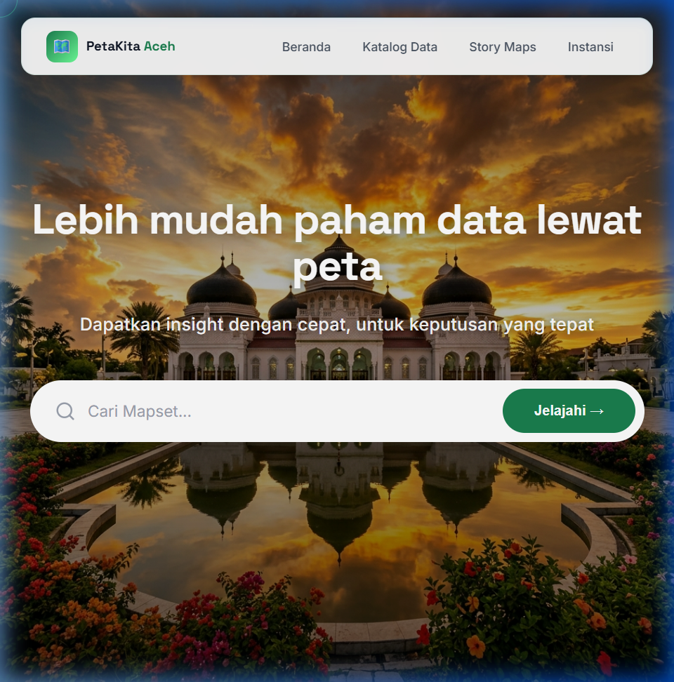
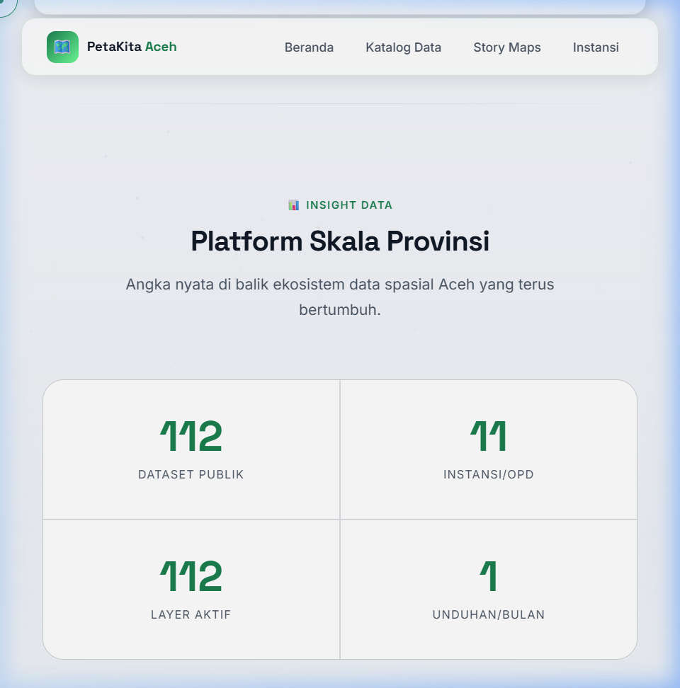
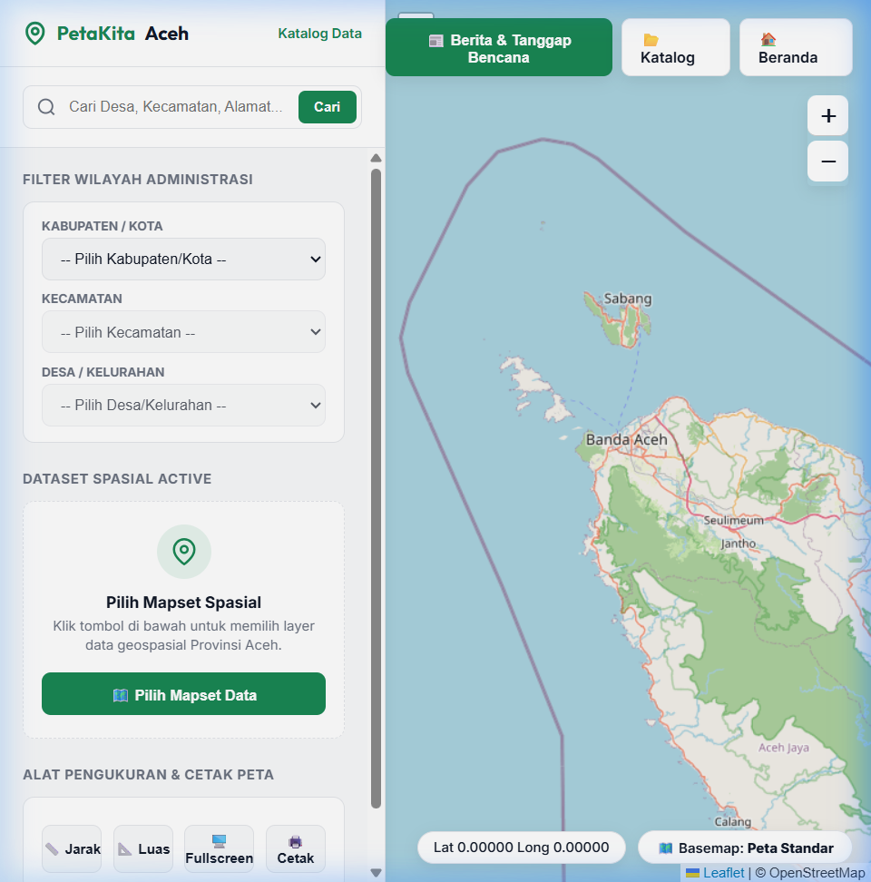
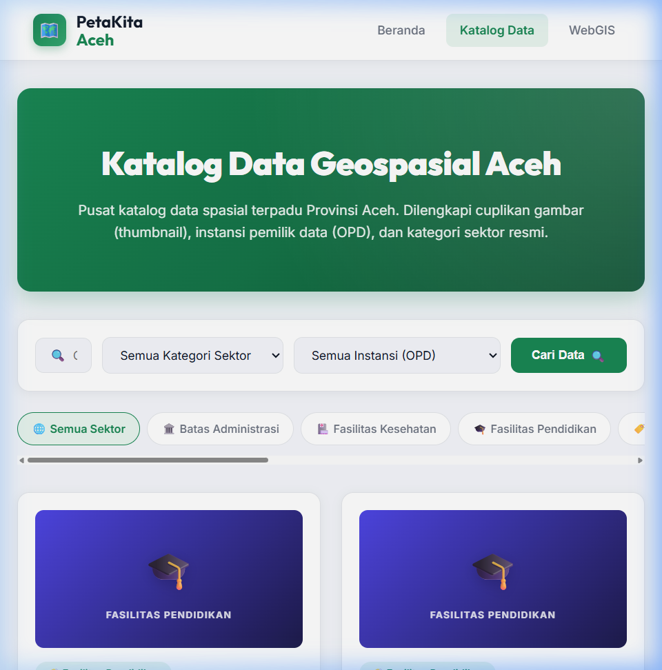
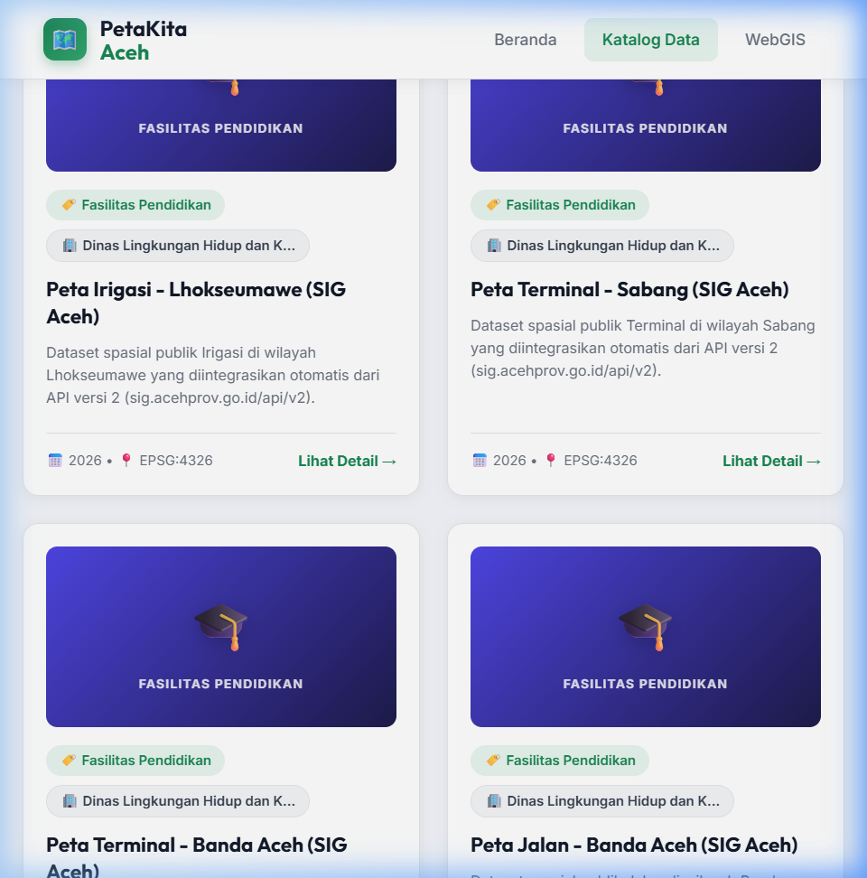

# Mockup dan Tampilan Antarmuka (UI) PetaKita Aceh

Dokumen ini memuat tangkapan layar (mockup) asli dari sistem PetaKita Aceh yang sedang berjalan. Anda dapat menggunakan gambar-gambar ini untuk keperluan presentasi kepada mentor, penyusunan laporan, atau demonstrasi visual.

## 1. Halaman Beranda (Landing Page)
Halaman depan portal yang modern, bernuansa Aceh, dan menampilkan informasi utama.

## 2. Insight & Statistik Data (Live)
Menampilkan jumlah Dataset Publik, Instansi (OPD) yang terdaftar, total layer yang aktif, dan grafik pertumbuhan dataset. Data ini ditarik secara otomatis (*live*) dari database.

## 3. WebGIS Viewer (Peta Interaktif)
Halaman utama eksplorasi data geospasial. Pengguna dapat memilih *basemap*, melihat poligon batas wilayah, titik lokasi fasilitas, serta menelusuri data melalui panel atribut.

## 4. Katalog Dataset
Halaman pencarian dan filterisasi dataset spasial berdasarkan OPD, Kategori, maupun kata kunci pencarian.

Menampilkan daftar kartu dataset (seperti Peta Irigasi, Jaringan Jalan, Fasilitas Pendidikan) yang siap diunduh dalam format GeoJSON.

---
*Catatan: Semua gambar (*mockup*) ini merupakan hasil tangkapan layar langsung (*screenshot*) dari aplikasi PetaKita Aceh versi terbaru yang berjalan di lingkungan pengembangan (lokal).*
